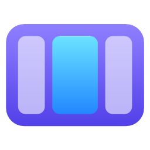
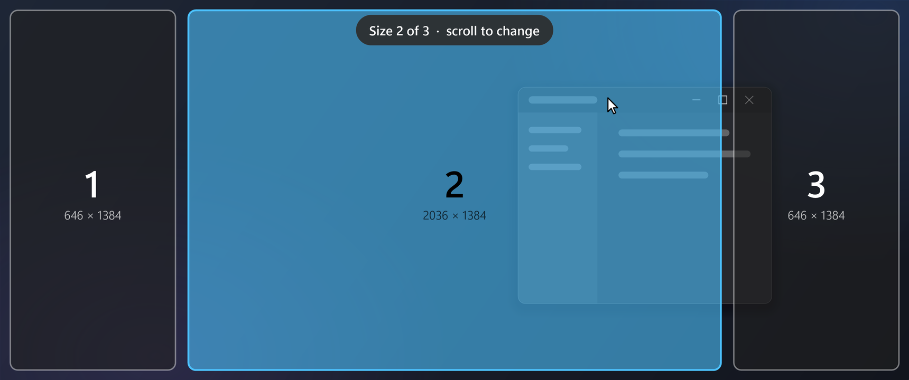
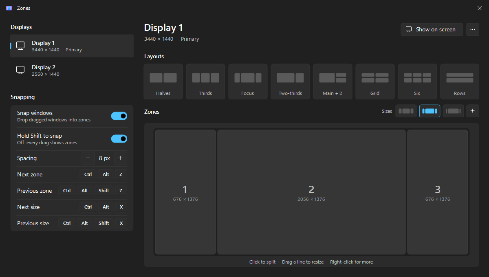
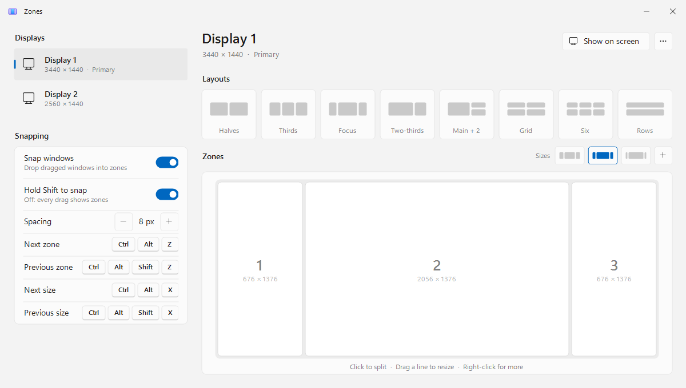
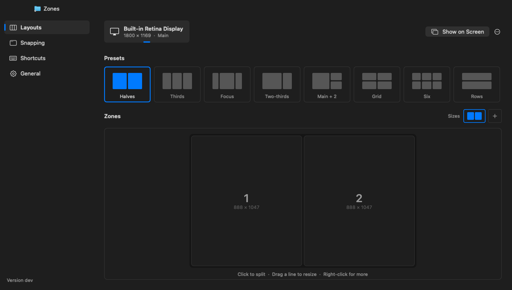

<p align="center">
  
</p>

<h1 align="center">Zones</h1>

<p align="center">
  <strong>Snap windows into zones you draw yourself, on Windows and macOS.</strong><br>
  Hold Shift, drag a window, drop it in a zone. Every display gets its own layout, in as
  many sizes as you like.
</p>

<p align="center">
  
</p>

<p align="center">
  
  
  
  
  
  
</p>

---

Windows and macOS both snap windows, but only into the shapes they come with:
halves, quarters, thirds at best. On an ultrawide, a portrait screen, or two
different monitors side by side, those are rarely the shapes you want, and there
is no way to draw your own.

Zones lets you. Every display has the layout you want, a wide centre on an
ultrawide, a main window and a stack beside it, two rows on a portrait screen,
and keeps more than one size of it, so the middle can be 50% now and 70% a
minute later without opening anything. It lives in the tray on Windows and the
menu bar on macOS.

## What it does

- **Shift-drag to snap.** Drag any window by its title bar with
  <kbd>Shift</kbd> held. The zones of the display under the cursor appear; let
  go over one and the window fills it. Let go near the line between two zones
  and it spans both. Drag it out again and it gets its own size back.
- **A layout per display.** Eight ready-made ones (halves, thirds, a wide
  centre, two-thirds, a main window and a stack, a grid, six, rows), or draw
  your own: click a zone to split it, drag the line between two zones to
  resize just those two.
- **Sizes.** Keep several versions of a display's layout, the middle at 50%,
  60% and 70% say, and flip between them with a shortcut. Every window snapped
  on that display moves with the zones, sides included. While Shift-dragging,
  the mouse wheel flips sizes before you drop.
- **Keyboard.** Shortcuts move the active window into its next or previous
  zone, round and round, and flip the display to its next or previous size.
  All four can be set to any keys.
- **Native on both.** C# and WinForms on Windows, Swift and AppKit on macOS.
  Light or dark, your accent colour, per-monitor scaling.
- **Updates itself.** A new release is downloaded quietly, checked, and
  installed while you are not using Zones, back in a second. One switch turns
  that off.

## A closer look

<table align="center">
  <tr>
    <td></td>
    <td></td>
  </tr>
  <tr>
    <td align="center"><sub><b>Dark</b></sub></td>
    <td align="center"><sub><b>Light</b>, following Windows</sub></td>
  </tr>
</table>
<p align="center"><sub>The settings window on Windows: an ultrawide with three sizes of a wide centre, the second in use.</sub></p>

<p align="center">
  
</p>
<p align="center"><sub><b>On macOS</b>, the same window and the same pages, with the Mac's own keys.</sub></p>

## Install

### Windows

Download `zones.exe` from the
[latest release](https://github.com/rui-branco/zones/releases/latest) and run
it. It is one small executable with no installer; the .NET Framework
4.8 it needs ships with Windows. It is not code-signed, so SmartScreen may ask
first: **More info**, then **Run anyway**.

Keep it somewhere permanent, such as `%LOCALAPPDATA%\Zones`, rather than
running it out of Downloads: an update replaces the running `zones.exe` where
it is, and **Start with Windows** points at that same path.

Right-click the tray icon for **Start with Windows** to have it there on every
login.

### macOS

Download `Zones-mac.zip` from the same
[release](https://github.com/rui-branco/zones/releases/latest), unzip it and
move **Zones.app** to **Applications**. It is not notarized, so the first
time, right-click it and choose **Open**, then **Open** again. If macOS only
offers to move it to the Bin, as macOS 15 and later do, open System Settings →
Privacy & Security and click **Open Anyway**.

macOS then asks for **Accessibility** access, which is what lets one app move
another's windows: turn Zones on in System Settings → Privacy & Security →
Accessibility. Use the menu bar icon for **Start at Login**.

## Using it

| | Windows | macOS |
| --- | --- | --- |
| Show the zones while dragging a window | <kbd>Shift</kbd> | <kbd>⇧</kbd> |
| Snap into a zone | Let go over it | Let go over it |
| Span two zones | Let go near the line between them | Let go near the line between them |
| Pick a size while dragging | Mouse wheel | Scroll |
| Active window to its next zone | <kbd>Ctrl</kbd>+<kbd>Alt</kbd>+<kbd>Z</kbd> | <kbd>⌃</kbd><kbd>⌥</kbd><kbd>Z</kbd> |
| Active window to its previous zone | <kbd>Ctrl</kbd>+<kbd>Alt</kbd>+<kbd>Shift</kbd>+<kbd>Z</kbd> | <kbd>⌃</kbd><kbd>⌥</kbd><kbd>⇧</kbd><kbd>Z</kbd> |
| Display to its next size | <kbd>Ctrl</kbd>+<kbd>Alt</kbd>+<kbd>X</kbd> | <kbd>⌃</kbd><kbd>⌥</kbd><kbd>X</kbd> |
| Display to its previous size | <kbd>Ctrl</kbd>+<kbd>Alt</kbd>+<kbd>Shift</kbd>+<kbd>X</kbd> | <kbd>⌃</kbd><kbd>⌥</kbd><kbd>⇧</kbd><kbd>X</kbd> |
| Open the settings | Click the tray icon | Menu bar icon → **Settings…** |

A window dragged out of a zone gets its own size back. Switching sizes, by
shortcut, by wheel or in the settings window, moves every window snapped on that
display along with its zone.

Every shortcut can be changed in the settings window: click it and press the
keys you want, or <kbd>Backspace</kbd> to turn it off.

## The settings window

Open it from the tray icon on Windows or the menu bar icon on macOS. A menu
down the left has four pages, with the version running at its foot.

- **Layouts**: a tab for each display across the top; pick one and its layout
  shows underneath, drawn to the display's real proportions with each zone's
  size in pixels.
  - **Presets**: click a ready-made layout to start from it.
  - **Sizes**: the strip beside "Zones". **+** copies the current size so you
    can drag its lines somewhere else; click a size to switch to it;
    right-click to remove one.
  - **Zones**: click to split, <kbd>Shift</kbd>+click to split across, drag a
    line to resize (it clicks into halves, thirds and quarters on the way
    unless you hold <kbd>Alt</kbd>/<kbd>⌥</kbd>), right-click to remove a zone
    or leave it empty, so a zone can sit in the middle with space around it
    (nothing snaps into empty space; Windows only for now).
  - **Show on screen** draws the layout over the real display. The **⋯** menu
    beside it has **Use on all displays**, which copies the layout, sizes and
    all, and **Reset this display**, back to the default.
- **Snapping**: turn snapping off, show zones on every drag instead of only
  with Shift (Shift then holds them back), and the gap around each zone.
- **Shortcuts**: the four shortcuts, each with what it does.
- **General**: start with Windows (at login on macOS), automatic updates, and
  the version, with a button to check for a newer one.

Every change is saved as you make it. The window can be resized; the zone
editor grows with it.

## Updates

Zones keeps itself up to date. It checks this repository's releases quietly,
once at launch and every six hours after, and downloads a newer one in the
background: `zones.exe` on Windows, `Zones-mac.zip` on macOS. The download is
checked against the `SHA256SUMS.txt` published with it, and thrown away if it
does not match. Zones then installs it by itself the next time it is idle, not
in the middle of a drag and not with the settings window open, and restarts in
a second.

To choose the moment yourself, turn off **Auto-update** on the settings
window's General page (or **Install updates automatically** in the tray menu or
the menu bar menu). A new release then shows as **Update to Zones 1.1.0** in
that menu, and as an **Update to 1.1.0** button at the foot of the settings
window's menu, and nothing changes until you click one of them.

On Windows the running executable is moved aside and the new one swapped in.
On macOS, Zones.app is replaced in place when it is in Applications, one more
reason to keep it there.

## Where things go

| What | Where |
| --- | --- |
| Settings, Windows | `%APPDATA%\Zones\config.json`, with the previous save kept as `config.json.bak` |
| Settings, macOS | `~/Library/Application Support/Zones/config.json` |
| The app, Windows | Wherever you put `zones.exe`; `install.ps1` uses `%LOCALAPPDATA%\Zones` |
| The app, macOS | `/Applications/Zones.app`; `install.sh` uses `~/Applications` |

Layouts are kept per monitor (its make, model and connector on Windows, the
display's UUID on macOS), so they stay with the screen when Windows numbers its
displays afresh after a reconnect or sleep. The same JSON shape on both: a tree
of runs and zones, each with
its share of the space. On Windows, a settings file that cannot be read is
moved aside and the `.bak` used instead, so a crash mid-save never costs you
your layouts.

## Building from source

### Windows

```powershell
git clone https://github.com/rui-branco/zones.git
cd zones\windows
.\install.ps1
```

`build.ps1` compiles `bin\zones.exe` with the C# compiler that ships with
Windows (.NET Framework 4.8, nothing to install). `install.ps1` builds, puts
`zones.exe` in `%LOCALAPPDATA%\Zones`, adds a Start Menu shortcut and starts it.

### macOS

```bash
git clone https://github.com/rui-branco/zones.git
cd zones/macos
scripts/install.sh
```

Needs the Xcode command line tools (Swift 5.9 or later).
`scripts/build-app.sh` builds `dist/Zones.app`; `scripts/install.sh` builds it,
puts it in `~/Applications` and opens it. Run the core's tests with
`swift test` in `macos/`.

A local build is signed ad hoc, so macOS treats every rebuild as a new app and
asks for Accessibility again after reinstalling.

### Layout

```
VERSION      the version both apps are built as
release.ps1  builds both and publishes them as a release
windows/     C# 5 / WinForms, built by build.ps1 with the in-box csc.exe
  src/App    startup, config, tray icon, updates
  src/Snap   layout model, drag snapping, overlay, shortcuts, settings window
  src/Ui     theme and the hand-drawn controls
macos/       Swift package
  Sources/ZonesCore   layout model and config (no AppKit, unit tested)
  Sources/Zones       menu bar app: engine, overlay, shortcuts, settings
  scripts/            build-app.sh, install.sh, package-release.sh, make-icon.swift
```

A release is made with `.\release.ps1` from a clean checkout of `main`: it
builds `zones.exe` here and `Zones-mac.zip` on a Mac over ssh, checks both say
the version in `VERSION`, writes `SHA256SUMS.txt`, and publishes the three as
a release here with the notes in `docs/release-notes/<version>.md`. `-DryRun`
builds and checks without publishing.

## Known limits

- **Windows running as administrator do not snap** on Windows: a normal
  program is not allowed to move an elevated one's windows.
- **Only resizable windows snap.** Fixed-size dialogs and palettes are left
  alone.
- **The system's own snapping still runs.** Dragging to a screen edge can
  still trigger Windows Snap or the macOS tiling bar; Zones wins when you drop
  on one of its zones.
- **Full-screen windows** (macOS) and minimized ones are skipped.

## Licence

MIT. See [LICENSE](LICENSE).
